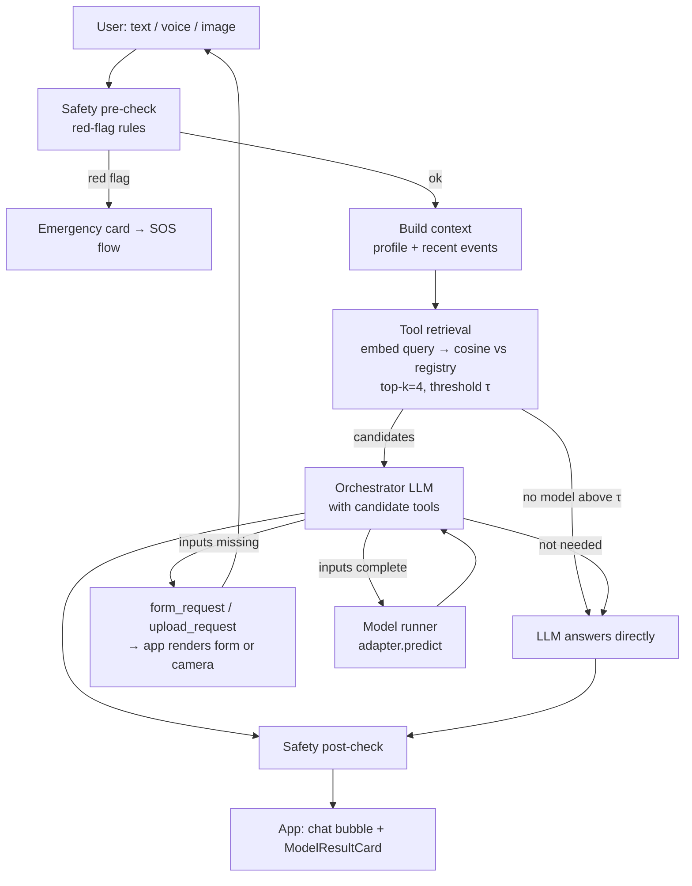

# Curanex: AI Doctor architecture (ML model router + LLM)

> For Claude Code. Read this together with `PLAN-2DAY.md` and `model_registry.json`.
> This replaces the plain "/chat → LLM" design of the Doctor module.

---

## 1. The idea, restated correctly

The team's idea: *"Turn ~100 pretrained ML repos into agents. When a user asks something, semantic search finds the right model, the model predicts, and the LLM explains the result. If no model fits, the LLM answers directly."*

The core is sound. Four parts of it need correcting before anything is built:

| Original idea | Problem | What we build instead |
|---|---|---|
| 100 **agents** | A classifier is a stateless function `input → probabilities`. Wrapping each one in its own agent adds latency, cost and failure points, and does no reasoning. | **One orchestrator agent** (the LLM) plus **N tools**, one tool per ML model. |
| Semantic search returns **the answer** | ML models are not documents. You can't retrieve an answer from them. You have to *run* them with the right inputs. | **Tool retrieval**: semantic search over *model descriptions* to choose which models are relevant. The model is then executed. |
| User asks → model answers | The diabetes model needs glucose, BMI, insulin and age. "I feel thirsty all the time" contains none of those. | **Slot filling**: the agent pre-fills inputs from the health profile and asks the user for the rest (dynamic form or image upload). Only then does the model run. |
| All ~126 repos usable | 69 need MRI/CT/EEG/ICU/pathology/genomics data that a phone user does not have, and many have no trained weights. | **Tiered registry** (see §3). Only tier A/B models with weights are exposed in the app. |

The fallback rule stays: **if no model is relevant, the LLM answers directly.** In practice the LLM *always* writes the final reply. ML output is evidence it explains, never text shown raw.

---

## 2. Request flow



Step by step:

1. **Safety pre-check.** Deterministic keyword/rule check. Chest pain with radiation, stroke signs, breathlessness, unconsciousness, heavy bleeding or suicidal intent → `escalate`. No LLM, no models.
2. **Context.** `get_user_context(user)` returns age, sex, height, weight, BMI, conditions, meds, allergies, the last few vitals and any uploaded image IDs. These pre-fill model inputs.
3. **Tool retrieval.** Embed `user message + last 2 turns`. Compare with pre-computed embeddings of each *integrated* model's `description`. Keep the top 4 above threshold τ. Start with τ = 0.35 for MiniLM and tune it on the test prompts in §9.
   - There are only ~126 entries, so use a numpy array and cosine similarity. **A vector DB is overkill here.**
   - Embeddings: `sentence-transformers/all-MiniLM-L6-v2` run locally, or the LLM provider's embedding API.
4. **Orchestrator.** One LLM call with tool use enabled. The available tools are the retrieved model tools plus `request_user_input` and `request_image`. The LLM decides whether to answer directly, ask for inputs, or run a model. Cap the loop at **3 tool calls per turn**.
5. **Model runner.** Calls the adapter, gets a standard `Prediction`, and logs it.
6. **Final answer.** The LLM explains the result in plain language: what the model checks, its confidence, what it *cannot* tell, and when to see a doctor.
7. **Safety post-check.** Remove dosing, block "you have X" wording, and make sure the "when to see a doctor" line is present.

---

## 3. Model registry (`model_registry.json`)

Already generated from the repository catalogue: **126 unique repos**.

| Tier | Meaning | Count | In app? |
|---|---|---|---|
| **A** | Input a user can provide on a phone: form fields, phone photo, text | 36 | ✅ |
| **B** | User uploads an existing medical image (X-ray, fundus, dermoscopy, mammogram); lower reliability | 21 | ✅, with a stronger warning |
| **C** | Needs hospital data (MRI, CT, EEG, ICU, pathology, genomics, endoscopy) or is a foundation model | 69 | ❌ shown only in the "Model library" screen as *clinic-grade / roadmap* |

`demo_candidate = tier A/B AND status W`: **29 repos.** None of them are verified yet.

Fields to fill per model when integrating:

```jsonc
{
  "id": "moizah1_diabetes_prediction",
  "repo": "Moizah1/Diabetes-Prediction",
  "modality": "tabular",            // tabular | phone_photo | medical_image_upload | text
  "app_tier": "A",
  "integrated": true,               // adapter exists and passes its smoke test
  "verified": true,                 // ran locally on a held-out sample
  "input_schema": {                 // JSON Schema; drives the LLM tool AND the app form
    "type": "object",
    "required": ["glucose", "bmi", "age"],
    "properties": {
      "glucose": {"type": "number", "unit": "mg/dL", "minimum": 40, "maximum": 400, "label": "Fasting glucose"},
      "bmi":     {"type": "number", "from_profile": true},
      "age":     {"type": "integer", "from_profile": true}
    }
  },
  "output_labels": ["low_risk", "high_risk"],
  "trained_on": "Pima Indians Diabetes dataset",
  "metrics": {"accuracy": null, "auc": null},   // fill from your own test run, not the README
  "limitations": "Trained on adult Pima women only; not validated for Indian population.",
  "license": "MIT",
  "description": "Type 2 diabetes risk from glucose, BMI, age... (used for retrieval)"
}
```

**Write each `description` for retrieval.** Include the symptoms and words a user would actually say ("frequent urination, thirst, sugar test"), not just the disease name. Retrieval quality depends almost entirely on this text.

---

## 4. Adapter pattern

Never import a cloned repo's code directly into the API. Each model gets an adapter that hides its quirks.

```
backend/
  main.py                    FastAPI: /chat, /upload, /models, /transcribe, ...
  orchestrator.py            retrieval + LLM tool loop
  safety.py                  pre/post checks
  context.py                 get_user_context
  registry.py                loads model_registry.json, embeddings cache
  runner.py                  lazy-load adapters, timeouts, logging
  adapters/
    base.py
    moizah1_diabetes_prediction.py
    mlmed_torchxrayvision.py
    ...
  models/<id>/               weights + any vendored code from the repo
  vendor/                    cloned repos (gitignored), used only to extract weights/code
  tests/test_adapters.py     one smoke test per integrated adapter
```

```python
# adapters/base.py
from dataclasses import dataclass, field

@dataclass
class Prediction:
    model_id: str
    label: str                       # top class
    probabilities: dict[str, float]  # all classes
    explanation: dict = field(default_factory=dict)  # e.g. feature contributions, heatmap image id
    warnings: list[str] = field(default_factory=list)  # e.g. "image looks like a phone photo of a screen"

class ModelAdapter:
    id: str
    def load(self) -> None: ...                      # called once, lazily
    def validate(self, inputs: dict) -> list[str]: ...  # returns missing/invalid fields
    def predict(self, inputs: dict) -> Prediction: ...
```

Runner rules:
- **Lazy-load** on first use and keep at most ~5 models in memory (LRU). Loading 126 models at startup will crash a laptop.
- Set a **10 s timeout** per prediction, run in a thread pool, and return a clean error to the orchestrator.
- **Dependency conflicts** (different torch/TF versions) are the biggest practical risk. For the demo, use one environment (torch, torchvision, scikit-learn, ultralytics, xgboost) and only integrate models that run in it. After the demo, isolate conflicting models as separate small services (one Docker container per framework family) behind the same adapter interface.
- For image models, validate the input: reject tiny images, warn on screenshots or photos of screens, and check the modality where possible (e.g. torchxrayvision on a selfie should be refused).

---

## 5. Orchestrator tools (what the LLM sees)

Each retrieved model becomes one tool, built automatically from the registry:

```jsonc
{
  "name": "run_moizah1_diabetes_prediction",
  "description": "<registry description> Limitations: <limitations>",
  "input_schema": <registry input_schema>
}
```

Plus two fixed tools:

```jsonc
{ "name": "request_user_input",
  "description": "Ask the user for missing model inputs. The app shows a form.",
  "input_schema": {"type":"object","required":["model_id","fields"],
    "properties":{"model_id":{"type":"string"},"fields":{"type":"array","items":{"type":"string"}},"reason":{"type":"string"}}}}

{ "name": "request_image",
  "description": "Ask the user to take or upload a photo/medical image for a model.",
  "input_schema": {"type":"object","required":["model_id","kind"],
    "properties":{"model_id":{"type":"string"},"kind":{"enum":["skin_photo","dental_photo","chest_xray","knee_xray","fundus"]},"instructions":{"type":"string"}}}}
```

The orchestrator system prompt must say:
- Use a model only when the user's question is about that condition **and** the model's inputs can be obtained. Otherwise answer normally.
- Pre-fill inputs from the context. Ask only for what is missing, and never ask for more than 5 fields at once.
- Never present a model result as a diagnosis. Say what it estimates, its confidence, the training-data limitations, and the next step (e.g. "an HbA1c test confirms this").
- If a model result conflicts with symptoms, trust the symptoms and recommend seeing a doctor.

`request_user_input` and `request_image` **end the turn**. The backend returns them to the app, and the user's answer arrives as the next `/chat` call with `form_values` or `image_id` attached.

---

## 6. API contract (backend → app)

`POST /chat` request:
```jsonc
{ "session_id": "...", "message": "I'm always thirsty and pee a lot",
  "context": { ...health profile from app... },
  "form_values": null, "image_id": null }
```

The response is a list of **blocks**, which the app renders in order:
```jsonc
{ "blocks": [
  { "type": "text", "text": "Frequent thirst and urination can have several causes..." },
  { "type": "form_request", "model_id": "...", "title": "Quick diabetes risk check",
    "fields": [ {"key":"glucose","label":"Fasting glucose","unit":"mg/dL","type":"number","optional":false} ],
    "prefilled": {"age": 34, "bmi": 27.1} },
  { "type": "upload_request", "model_id": "...", "kind": "skin_photo", "instructions": "Good light, 10–15 cm away" },
  { "type": "model_result", "model_id": "...", "model_name": "Diabetes risk (Pima)",
    "label": "high_risk", "probabilities": {"low_risk":0.28,"high_risk":0.72},
    "trained_on": "...", "limitations": "...", "heatmap_url": null },
  { "type": "escalate", "reason": "possible heart attack" }
]}
```

`POST /upload` (multipart) → `{ image_id }`. Images are stored on the backend for the session only.
`GET /models` → the registry, so the app can show the Model Library screen.

---

## 7. App UI additions (Doctor tab)

- **DynamicForm** rendered from `form_request.fields`. Pre-filled values are shown greyed out with an edit option, plus a "Why do we need this?" note.
- **Upload sheet**: camera or gallery, a framing guide overlay per `kind`, and a preview before sending.
- **ModelResultCard**: label, probability bar, a "Model: … · Trained on: …" footer, an expandable *Limitations* section, and a Grad-CAM heatmap if one is available. It always carries a "Not a diagnosis" badge.
- **"Analyzed by" chip** on chat bubbles that used a model, so users and evaluators can see when ML vs the LLM answered.
- **Model Library screen** (Profile → AI models): all 126 models grouped by the 17 categories, with badges *Active* (integrated) · *Available soon* (tier A/B) · *Clinic-grade* (tier C). This shows the full scope honestly, without claiming that 126 models run.

---

## 8. Optional: knowledge RAG (post-demo)

Add a second retriever over trusted medical text (e.g. MedlinePlus, WHO fact sheets, ICMR guidelines; check each licence). Chunk, embed and store it, then pass the top 3 chunks to the final answer with citations. This grounds the *explanations*. It is separate from model routing. **Skip it for the 2-day demo.**

---

## 9. 2-day integration scope

**Integrate 5–6 models, not 126.** Pick ones that are likely to run quickly and cover the main modalities:

| # | Model | Modality | Why |
|---|---|---|---|
| 1 | `mlmed/torchxrayvision` | Chest X-ray upload | `pip install torchxrayvision`, weights download automatically, well maintained. **Do this first.** |
| 2 | `Moizah1/Diabetes-Prediction` | Tabular form | Usually a scikit-learn pickle |
| 3 | `Sneha798/Heart-Disease-Prediction-Project` | Tabular form | Same |
| 4 | `smon2006/Skin-Disease-Detection` | Phone photo | Shows the camera flow |
| 5 | `AndreyGermanov/yolov8_caries_detector` | Phone photo | `ultralytics`, easy to load |
| 6 (stretch) | `SanyaB1801/Thyroid-Disease-Prediction` or `SathwikaEga/pcos-detection` | Tabular | Women's health angle |

**45-minute rule per repo:** if it does not produce a prediction within 45 minutes (missing weights, broken dependencies, unclear preprocessing), drop it and pick the next demo candidate. For tabular tasks, the honest fallback is to retrain a small model on the same public dataset (e.g. Pima diabetes, UCI heart) and label it in the registry as *"retrained by Curanex team"*.

**Per integrated model, before the demo:**
- [ ] Adapter plus smoke test passes
- [ ] Licence checked and recorded
- [ ] Run on 20–50 held-out samples; record accuracy (and sensitivity/specificity) in `metrics`. These numbers go in the slides.
- [ ] Retrieval test: 5 user phrasings that *should* pick this model and 5 that should not

**Retrieval test set** (`tests/retrieval_cases.json`). Write ~40 prompts with an expected `model_id` or `null`. Include traps: "what's a healthy breakfast" → null; "my chest X-ray report says opacity" → torchxrayvision; "I have a rash on my arm" → skin model; "my tooth hurts when I eat sweets" → caries. Tune τ until the false-positive rate is low. **A wrong model firing is worse than no model.**

---

## 10. Who builds what (if more than one person)

- **Person A (ML):** adapters, registry fields, runner, metrics. Works only in `backend/adapters`, `backend/models`, `model_registry.json`.
- **Person B (backend):** orchestrator, retrieval, safety, `/chat` block contract.
- **Person C (app):** blocks renderer, DynamicForm, upload sheet, ModelResultCard, Model Library.
- Agree on the §6 contract first. B and C can then mock it and work in parallel.

---

## 11. Presenting it honestly

Say: *"Curanex has a registry of 126 open-source medical models across 17 specialties. 57 accept inputs a phone user can provide. For this demo we integrated and evaluated N of them through a model-routing agent; the rest are catalogued, with a path to integration."*

Do not say "100 AI agents diagnose diseases". Evaluators will ask for accuracy numbers, which you won't have for 120 of them. That claim is also the kind that would make the app a regulated medical device.
