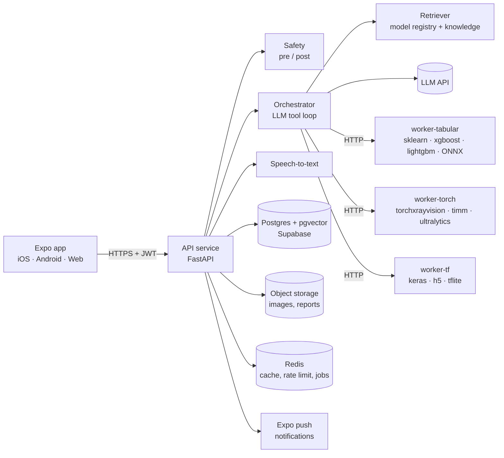

# Curanex backend: full plan and requirements

> For the team and for Claude Code. Read with `ARCHITECTURE.md` (how the AI doctor routes questions to models), `REPO_AUDIT.md` (what is actually inside the 126 repos) and `model_registry.json`.
> The app (`curanex-app/`) already calls `/health`, `/chat`, `/upload` and `/models`, and expects the response contract in ARCHITECTURE.md §6.

---

## 0. What the repo audit changed

All 126 repos were scanned (file tree, licence file, requirements; no code run). Findings that shape this plan:

| Finding | Number | Consequence |
|---|---|---|
| Repos the app can use (tier A/B) | 57 | Everything else needs hospital data |
| …of those, with model files actually in the repo | **30** | The catalogue's "W" label was wrong for several. **`smon2006/Skin-Disease-Detection` has no weights**, so it's replaced by `OmerKurtulus/skin-disease-classification` (MIT, `.keras` weights) |
| …of those, with **no licence file** | **30** | Without a licence you have no right to redistribute. That's fine for a college demo run on your own server. For a public launch: ask the author, or retrain on the same public dataset |
| Frameworks across all repos | sklearn 67, PyTorch 53, TensorFlow 26, XGBoost 22, Ultralytics 10 | They can't share one Python environment. You need **separate model workers** per framework family (§3) |
| Weights stored as `.pkl` / `.joblib` / `.sav` | most tabular models | **Loading a pickle runs code.** Untrusted pickles must be loaded in a sandbox once, then converted to ONNX (§6) |
| Repos that are notebooks only | several | You'll have to extract the preprocessing yourself. Budget extra time |

**Integration waves** (stored in `model_registry.json → wave`):
- **Wave 1 (8):**
  - `mlmed/torchxrayvision`: chest X-ray (Apache-2.0)
  - `Moizah1/Diabetes-Prediction`: includes a SHAP explainer
  - `Sneha798/Heart-Disease-Prediction-Project` (MIT)
  - `yahyazuher/AI-Liver-Disease-Diagnosis-System` (MIT)
  - `OmerKurtulus/skin-disease-classification` (MIT)
  - `AndreyGermanov/yolov8_caries_detector` (GPL: fine to run on your own server, but don't ship its code inside the app)
  - `joystonmenezes/xray-vision`: bone X-ray, ONNX file, MIT
  - `singh2010nidhi/Heart-Failure-Prediction-using-MSAzure`: ONNX file
- **Wave 2 (15):**
  - Thyroid ×2, PCOS, hypertension, anemia, gestational diabetes, preeclampsia
  - Knee osteoarthritis, ocular diseases, TB segmentation, dental caries #2
  - Diabetes #2, heart attack, bone age, COPD
- **Backlog (34):** no weights, or weights hosted elsewhere. Each needs retraining or a download first.
- **Hospital-only (69):** listed in the Model Library and never routed from the app.

---

## 1. System overview



**Why separate workers:** one Python environment can't hold TensorFlow 2.x, PyTorch, Ultralytics and three different scikit-learn versions at once. Each worker is a small FastAPI service with its own `requirements.txt` and Docker image. The API calls them over HTTP. Adding a model only touches one worker.

**Monolith first:** run everything with one `docker compose up`. The services are split so that each one can be moved to its own machine later (the torch worker onto a GPU machine, say) without code changes.

---

## 2. Components and responsibilities

| Component | Responsibility | Key tech |
|---|---|---|
| **api** | Auth, routing, validation, rate limits, the `/chat` block contract, uploads, profile sync | FastAPI, Pydantic v2, SQLAlchemy/asyncpg |
| **safety** | Deterministic red-flag rules (+ later a small classifier), dose stripping, wording checks, crisis routing | Python module inside api; unit-tested |
| **orchestrator** | Builds user context → retrieves candidate models → LLM tool loop (max 3 calls) → final explanation | LLM SDK with tool use |
| **retriever** | Embeds model descriptions; top-k + threshold; later medical-knowledge RAG with citations | sentence-transformers or embedding API; pgvector |
| **model workers** | Load adapters lazily, validate input, predict, explain (SHAP/Grad-CAM), enforce timeouts | FastAPI per worker; ONNX Runtime where possible |
| **model registry** | Single source of truth: schemas, labels, licence, metrics, wave, status | `model_registry.json` → DB table `models` |
| **nutrition** | Food-photo recognition, meal plans, nutrient lookup (Indian foods) | Multimodal LLM + IFCT food table |
| **trainer** | Workout plans with contraindication rules | LLM with JSON schema + rule filter |
| **reports** | Lab-report OCR → values → plain-language explanation → trend storage | Multimodal LLM (structured output) |
| **voice** | Audio → text | Whisper API or self-hosted faster-whisper |
| **jobs** | Med reminders, weekly summaries, slow image jobs | Redis + RQ/Celery, Expo push |
| **observability** | Logs (no health data), traces, LLM call logs, errors | structlog, Sentry, Langfuse (optional) |

---

## 3. Model platform (the core of the ML work)

### 3.1 Adapter contract (same in every worker)
```python
class ModelAdapter:
    id: str
    def load(self) -> None: ...                          # lazy, once
    def validate(self, inputs: dict) -> list[str]: ...   # missing / out-of-range fields
    def predict(self, inputs: dict) -> Prediction: ...   # label, probabilities, explanation, warnings
```
Worker endpoints: `GET /health`, `GET /models` (what this worker serves), `POST /predict/{model_id}`.

### 3.2 Onboarding pipeline: repo → verified model

Use this for every model, scripted under `tools/`:

1. **Probe** (done for all 126): check for files, licence and framework. Re-run with `tools/probe_repos.py`.
2. **Triage:** check that weights exist, the licence is acceptable, and the input is phone-friendly. Then pick a worker.
3. **Sandbox load:** run the repo's model in a throwaway container with **no network and no secrets**. Inspect the expected features and preprocessing.
4. **Convert:** export to ONNX (`skl2onnx`, `onnxmltools` for XGBoost/LightGBM, `tf2onnx`, `torch.onnx`). Where conversion fails, pin the exact library version in that worker.
5. **Adapter + schema:** write the adapter and fill `input_schema` (units, ranges, `from_profile`), `output_labels`, `trained_on`, `limitations`.
6. **Evaluate:** run on a held-out public dataset for the same task. Record accuracy, sensitivity, specificity and AUC in `metrics`. **No metrics, no `verified=true`.**
7. **Register:** set `integrated=true` and write a retrieval-friendly `description` in the words users actually say. Re-embed.
8. **Retrieval test:** 5 phrases that should route to this model and 5 that shouldn't, added to `tests/retrieval_cases.json`.

Time box: **45 minutes per repo for steps 3–5.** If it isn't running by then, move it to the backlog with a note.

### 3.3 Explanations
- Tabular: SHAP top-3 contributing features ("glucose and BMI drove this most"). The Moizah1 repo already ships a SHAP explainer.
- Images: a Grad-CAM heatmap, returned as an `image_id` and shown in the result card.
- Always: `trained_on`, `limitations`, and the model's measured metrics, shown in the app.

---

## 4. API specification (v1)

All routes are under `/v1`. Auth is a JWT (Supabase Auth) via `Authorization: Bearer`.

| Method | Path | Purpose |
|---|---|---|
| GET | `/health` | Liveness (no auth) |
| GET | `/v1/me` · PUT `/v1/me/profile` | Health profile sync (the app currently keeps it locally; sync is optional per consent) |
| POST | `/v1/chat` | Doctor turn → `blocks[]` (text, form_request, upload_request, model_result, escalate) |
| POST | `/v1/uploads` | Image/PDF upload → `{ upload_id }` (validated type/size, EXIF stripped) |
| POST | `/v1/transcribe` | Audio → `{ text, language }` |
| POST | `/v1/reports/explain` | Lab report → extracted values + explanation + flags |
| POST | `/v1/nutrition/food-photo` | Photo → dishes, portions, macros (editable) |
| POST | `/v1/nutrition/meal-plan` | Context → day/week plan (respects diet, conditions, allergies) |
| POST | `/v1/trainer/workout-plan` | Context → workout (contraindication-filtered) |
| GET | `/v1/models` · GET `/v1/models/{id}` | Registry for the Model Library screen |
| POST | `/v1/models/{id}/predict` | Direct model call (used by the form/upload flow; still goes through safety) |
| GET | `/v1/places/hospitals?lat&lng` | Nearby hospitals (Google Places) |
| POST | `/v1/push/register` | Expo push token for reminders |
| DELETE | `/v1/me` | Delete account and all data (DPDP right to erasure) |

The block contract is in ARCHITECTURE.md §6. **Keep `/chat` (no version prefix) working until the app moves to `/v1/chat`.**

---

## 5. Data model (Postgres)

```
users(id, auth_id, created_at, consent_version)
profiles(user_id, dob, sex, height_cm, weight_kg, blood_group, diet, goal, updated_at)
conditions / allergies / medications(user_id, ...)
emergency_contacts(user_id, name, phone, relation)
chat_sessions(id, user_id, started_at, mode)          chat_messages(id, session_id, role, blocks_json, created_at)
model_runs(id, user_id, model_id, model_version, inputs_hash, output_json, latency_ms, created_at)   -- audit trail
uploads(id, user_id, kind, storage_path, sha256, created_at, expires_at)
reports(id, user_id, upload_id, values_json, summary, created_at)
meals, workouts, vitals, med_logs(user_id, ...)
models(id, registry_json, embedding vector(384), integrated, verified, wave, updated_at)
knowledge_chunks(id, source, url, text, embedding vector(384))         -- phase 7
consents(user_id, category, granted, updated_at)
```
- Row Level Security on every user table (`user_id = auth.uid()`).
- Uploads expire after 30 days by default unless the user saves them to their records.
- `model_runs` stores a **hash** of the inputs, not the raw values, unless the user has consented to storing their history.

---

## 6. Security, privacy and safety requirements

1. **Pickles are code.** Never `pickle.load`/`joblib.load` a downloaded file in the API process. Load it once in an isolated container with no network, convert it to ONNX, and serve the ONNX file. Store a SHA-256 of every weight file in the registry and check it at load time.
2. **Secrets** live only in server environment variables, never in the app, Git, logs or model containers.
3. **Health data** must be encrypted in transit (HTTPS) and at rest (managed Postgres and storage). Logs and analytics contain no health data.
4. **India's DPDP Act, 2023:** explicit consent per purpose, a data-export option, account deletion, and purpose limitation.
5. **Uploads:** check type and size (≤10 MB), strip EXIF metadata (which can include location), and reject non-images for image models.
6. **Safety layer** on every AI route: deterministic red flags first, then dose stripping, no "you have X" wording, and crisis routing for self-harm. Run a red-team prompt set (≥50 prompts) in CI.
7. **Medical-device boundary:** results are framed as screening and education, never as a diagnosis. A public launch would need a regulatory review.
8. **Rate limits:** per user and per IP (e.g. 30 chat turns per 10 minutes). Cap LLM tokens per turn.
9. **Audit:** every model run and LLM call is logged with model, version and latency (no raw health data).

---

## 7. Requirements

### 7.1 Functional requirements
| ID | Requirement |
|---|---|
| FR-1 | The user can chat (text) and get a context-aware answer in < 6 s (p90) |
| FR-2 | Red-flag messages return `escalate` within 300 ms without calling any AI |
| FR-3 | When a registered model fits, the system asks for the missing inputs (form or image), runs the model and explains the result |
| FR-4 | When no model fits (similarity < τ), the LLM answers directly |
| FR-5 | Every model result shows the label, probabilities, "trained on", limitations and "not a diagnosis" |
| FR-6 | Voice: audio → text → answer; the app speaks the reply |
| FR-7 | Lab report photo/PDF → values, flags, explanation |
| FR-8 | Food photo → editable items with macros; meal plans respect diet type, conditions and allergies |
| FR-9 | Workout plans exclude contraindicated exercises |
| FR-10 | The Model Library lists all models with status, licence and metrics |
| FR-11 | The user can export and delete all their data |

### 7.2 Non-functional requirements
| Area | Target |
|---|---|
| Latency | Safety < 300 ms; tabular model < 300 ms; image model < 3 s on CPU; chat turn < 6 s p90 |
| Availability | Demo: best effort. Production: 99.5% for the API; SOS never depends on the backend (already true in the app) |
| Retrieval quality | ≥ 85% correct routing on the test set; false-positive model calls < 5% |
| Model quality | Each verified model has measured metrics on held-out data, shown in the app |
| Privacy | No health data in logs; encryption in transit and at rest; RLS |
| Scalability | Workers scale independently; torch worker can move to a GPU machine |
| Portability | Everything runs with `docker compose up` on one machine |

### 7.3 Software requirements
| Item | Version / choice |
|---|---|
| Python | 3.11 (best wheel support across torch/TF/ONNX) |
| API | FastAPI, Uvicorn, Pydantic v2, SQLAlchemy 2 / asyncpg, python-multipart, httpx |
| Workers | ONNX Runtime; scikit-learn / XGBoost / LightGBM (tabular); PyTorch + torchvision + torchxrayvision + timm + ultralytics (torch); TensorFlow 2.x (tf) |
| Retrieval | sentence-transformers (`all-MiniLM-L6-v2`) or a provider embedding API; numpy now, pgvector later |
| Explainability | shap, pytorch-grad-cam |
| Data | PostgreSQL 15+ with pgvector (Supabase free tier works); Redis 7 |
| Speech | OpenAI Whisper API or `faster-whisper` (self-hosted) |
| Tooling | Docker + Docker Compose, pytest, ruff, pre-commit, GitHub Actions |
| Conversion | skl2onnx, onnxmltools, tf2onnx |

Exact package lists are in `backend/requirements/*.txt`.

### 7.4 Hardware requirements
| Use | Minimum | Comfortable |
|---|---|---|
| Developer laptop | 8 GB RAM, 20 GB free disk, any CPU | 16 GB RAM, 50 GB free (model repos and weights add up) |
| Demo server (all workers, CPU) | 4 vCPU, 16 GB RAM | 8 vCPU, 32 GB RAM |
| GPU (optional) | Only for many concurrent image requests, YOLO speed, or MedGemma-style models | 1× NVIDIA T4 (16 GB) or similar |
| Free Colab/Kaggle GPU | For retraining or evaluating models offline | |

Most wave-1/2 models are small CNNs or tree models, so **CPU is enough for a demo.** Heavy foundation models (e.g. the MedGemma LoRA in `Eeman1113/dental_study`) are out of scope until you have a GPU.

### 7.5 Accounts and API keys
| Need | Option | Notes |
|---|---|---|
| LLM (chat, tool use, vision) | Anthropic API (or another provider behind the same interface) | Required. Put the key in `.env` on the server only |
| Embeddings | Local sentence-transformers (free) or provider API | Local is fine for 126 models |
| Speech-to-text | OpenAI Whisper API, or self-host faster-whisper | Self-hosting needs more CPU/GPU |
| Database + auth + storage | Supabase project | Free tier is enough to start |
| Maps / hospitals | Google Places API key | The app currently opens Google Maps instead, so this is optional |
| Push notifications | Expo account | Free |
| Hosting | Render / Railway / Fly.io (simple) or AWS / GCP / Azure (student credits) | Pick a region close to India (e.g. Mumbai) for latency |
| Errors / monitoring | Sentry free tier | Optional |

### 7.6 Datasets (for evaluating models, not shipped)
You need a held-out test set per model to report honest metrics, for example: Pima Indians Diabetes, UCI Heart Disease, Indian Liver Patient, NIH ChestX-ray14 / RSNA Pneumonia (torchxrayvision tasks), MURA (bone X-ray), ISIC (skin lesions), and the repo's own test split where one is provided. **Check each dataset's licence.** Several allow research use only.

### 7.7 People and skills
- **ML engineer:** model onboarding pipeline, conversion, evaluation, model cards.
- **Backend engineer:** API, orchestrator, safety, DB, auth, deployment.
- **App developer:** connect screens to the real endpoints (the UI already exists).
- **Clinical reviewer (even informal, e.g. a doctor you know):** review the safety rules, first-aid text and result wording.

---

## 8. Folder structure

```
backend/
  api/
    main.py               app factory, routers
    routers/              chat.py uploads.py voice.py nutrition.py trainer.py reports.py models.py me.py places.py
    core/                 config.py auth.py db.py ratelimit.py logging.py
    safety/               rules.py postcheck.py redteam_prompts.json
    orchestrator/         context.py retriever.py tools.py loop.py prompts.py
    clients/              llm.py stt.py workers.py places.py push.py
    schemas/              blocks.py chat.py ...
  workers/
    common/               adapter.py server.py (shared FastAPI app for any worker)
    tabular/              adapters/*.py  models/<id>/*.onnx  requirements.txt  Dockerfile
    torch/                adapters/*.py  models/<id>/        requirements.txt  Dockerfile
    tf/                   adapters/*.py  models/<id>/        requirements.txt  Dockerfile
  registry/model_registry.json
  tools/                  probe_repos.py  onboard_model.py  convert_onnx.py  evaluate.py  embed_registry.py
  tests/                  test_safety.py test_chat_contract.py test_retrieval.py retrieval_cases.json workers/
  vendor/                 cloned repos (gitignored; read-only source material)
  docker-compose.yml  .env.example
```

---

## 9. Build phases

Each phase ends with something you can demo, and its tests pass.

| Phase | Scope | Done when |
|---|---|---|
| **B0 Foundation** | Folder structure, config, Docker Compose (api + redis + postgres), CI with pytest + ruff | `docker compose up` → `/health` OK; CI green |
| **B1 Safety + chat** | Safety module + red-team set; `/chat` with LLM and user context; block contract tests | Red flags escalate in < 300 ms; contract tests pass; the app shows "Connected" |
| **B2 Model platform** | Worker template; tabular + torch workers; registry loader; retriever; orchestrator tool loop; `/uploads` | "Here is my chest X-ray" → torchxrayvision result in the app; "healthy breakfast" → no model |
| **B3 Wave 1** | The other 7 wave-1 models via the onboarding pipeline, with metrics and SHAP/Grad-CAM | 8 models verified, each with metrics; retrieval ≥ 85% |
| **B4 Nutrition, trainer, reports** | food-photo, meal-plan, workout-plan, reports/explain | A diabetic profile gets a different meal plan; a CBC photo gets explained |
| **B5 Voice** | `/transcribe` + app recording | Voice round trip < 5 s; red flags work by voice |
| **B6 Accounts + sync** | Supabase auth, profile sync with consent, delete/export, push reminders | Sign-in on two devices shows the same data; delete removes everything |
| **B7 Wave 2 + knowledge RAG** | 15 more models; trusted medical text with citations in answers | 23 verified models; answers cite sources |
| **B8 Hardening + deploy** | Rate limits, Sentry, load test, hosting, backups, security review | Deployed URL; the app's production build points to it |

**Order rule:** never start the next wave of models before retrieval tests pass for the current one. A wrong model firing is worse than no model.

---

## 10. Claude Code prompts (one per phase)

**B0**
```
Read docs/BACKEND_PLAN.md, docs/ARCHITECTURE.md and backend/main.py. Restructure backend/ into the folder layout in BACKEND_PLAN §8 without breaking the existing /health, /chat, /upload and /models routes (the app depends on them). Add config via pydantic-settings, structured logging, docker-compose.yml (api, postgres with pgvector, redis), ruff + pytest config and a GitHub Actions workflow. Move the existing safety tests. Run tests and show results. Stop.
```
**B1**
```
Do BACKEND_PLAN phase B1. Expand safety rules, add backend/api/safety/redteam_prompts.json (≥50 prompts with expected outcomes) and a test that runs them. Implement /chat with the LLM client (provider behind one interface, key from env), user context from the request, and the blocks contract from ARCHITECTURE §6 with pydantic schemas and contract tests. Stop and report test results.
```
**B2**
```
Do BACKEND_PLAN phase B2. Build workers/common (adapter base + FastAPI server: /health, /models, /predict/{id}, lazy load, LRU, 10 s timeout), the tabular and torch workers with Dockerfiles, the registry loader, the embedding retriever (top-k=4, threshold from env) and the orchestrator tool loop (ARCHITECTURE §5) in api/. Integrate mlmed/torchxrayvision first. Add /v1/uploads with type/size checks and EXIF stripping. Show me the chest X-ray flow working end to end. Stop.
```
**B3 (repeat per model)**
```
Onboard <REPO> using BACKEND_PLAN §3.2. Clone into backend/vendor/, load it ONLY inside a container with no network, report the features, preprocessing, labels and licence, convert to ONNX if possible, write the adapter in the right worker, fill the registry fields, evaluate on a held-out public dataset (tell me which) and record real metrics, add 10 retrieval test cases. Apply the 45-minute rule. Never mark verified without metrics. Stop and report.
```
**B4–B8:** same pattern. Name the phase, point at its row in §9, and ask for a stop-and-report at the end.

---

## 11. Risks

| Risk | Likelihood | Mitigation |
|---|---|---|
| Repo weights don't load (version drift) | High | ONNX conversion; pinned per-worker environments; 45-minute rule; retrain fallback |
| Model trained on a non-Indian population performs worse here | High | Say so in `limitations`; evaluate on Indian data where available |
| Wrong model routed | Medium | Threshold tuning, retrieval tests, LLM can decline the tool |
| Licence problems | Low: the team has permission from all authors | Keep the written permissions in docs/permissions/; check GPL repos (e.g. YOLO caries) still stay server-side if the app is ever distributed with them |
| Over-trust of results by users | Medium | Wording rules, "not a diagnosis", next-test suggestions, red-flag escalation |
| LLM cost or outage | Medium | Token caps, caching, a fallback message; SOS works without the backend |
| Malicious pickle | Low but severe | Sandbox + ONNX + SHA-256 pinning |
